# Walking Memories — how this repository works

*A guide to the code, the content flow and the publishing chain of the open-source artist's book by
Chris-Armel Iradukunda (daqhris). GitHub shows this file first on the `printlab` branch; the book's own
cover page is [`README.md`](../README.md) and stays GitBook's.*

Three publishing sources live in one repository: the **text** is written in GitBook, remixed here into a
custom web book and a print layout, and the **photographs** come from the blockchain. This page maps how
each piece travels, what each folder is for, and what is needed to keep it alive.



<sub>Source: [`docs/flow.mmd`](../docs/flow.mmd) (Mermaid) · [SVG](../docs/flow.svg) · [PNG](../docs/flow.png).
Re-render: `mmdc -i docs/flow.mmd -o docs/flow.svg`.</sub>

---

## 1. Branches and addresses

| Branch | What it is | Address | Edited by |
|---|---|---|---|
| **`book`** (default) | The GitBook source. GitBook syntax (``, ``), `.gitbook/assets`. 1 379 commits, 886 of them `GITBOOK-n`. | `book.awalkaday.art` (GitBook) | GitBook editor, two-way sync |
| **`printlab`** | The custom platform: Jekyll web book, print layout, PDF pipeline, photo mirror. Started from `book` at *GITBOOK-537* (2026-03-16). | `printlab.awalkaday.art` (GitHub Pages) | Pull requests, by hand and with Claude |
| `about` | Static "about" site (HTML, fr/zh pages, 478 commits, last 2026-02). Separate project. | `about.awalkaday.art` | by hand |
| `main` | Early Replit-era static site (57 commits, last 2024-01). Historical. | `about.awalkaday.art` (CNAME) | – |

`printlab` never pushes to `book`. Text goes **from GitBook to printlab**, not back (see §4).

## 2. What is in the repo

| Path | Role | Layer | Status |
|---|---|---|---|
| `README.md`, `SUMMARY.md`, `.gitbook/` | GitBook's cover page, table of contents, uploaded images | GitBook mirror | **Do not restyle.** Keep identical to `book` so syncs merge cleanly |
| `index.md`, `*.md`, `<folder>/*.md` (33 pages) | The web book: one Markdown file per page, Jekyll front matter, HTML figures | Web | Live: published by `deploy.yml` |
| `_data/toc.yml`, `_includes/nav.html` | Web menu (mirrors `SUMMARY.md` by hand) | Web | Live. Check with `content-sync.py toc` |
| `_layouts/` (`default`, `page`, `impression`) | Page frames. `impression.html` loads Paged.js | Web + print | Live |
| `assets/css/screen.css` | Screen styling | Web | Live |
| `assets/css/print.css`, `assets/js/paged.polyfill.js`, `assets/fonts/` | Print layout (CSS Paged Media), Paged.js 0.4.3 (vendored), fonts | Print | Live |
| `impression.md` | The book as printed: cover, 32 chapters via `include_relative`, back cover | Print | Live. Page break rules: `.chapter:not(.sub)` |
| `_chapters/*.md` | Print copy of each web page (excluded from Jekyll, pulled in by `impression.md`) | Print | Live, **drifted** from the web pages (§5) |
| `assets/photos/`, `assets/photos/web/`, `assets/external/` | Local photo copies: 1600 px for print, 800 px for the web, mirrored third-party logos | Both | Generated by `fetch-photos.py` |
| `data/photos.csv` | Ledger: token ID ↔ Arweave txid ↔ chain check ↔ SHA-256 ↔ file | Both | Generated. **Commit it** |
| `data/photo-overrides.csv`, `data/photos-needs-review.csv` | Human answers / open questions about which token an image is | Both | Edit the first by hand |
| `_data/exhibition.yml`, `_includes/exhibition-mark.html` | One source for the Venice Biennale captions and credits (back cover, Imprint web + print, home-page band). Edit the YAML, not the pages | Both | Live |
| `_data/seo.yml`, `robots.txt`, `llms.txt`, `photographs.json`, `CITATION.cff`, `assets/icons/`, `assets/social/` | Search and machine-readability (§8) | Web | Live |
| `data/chapters-map.csv` | Which web page feeds which print chapter | Tooling | By hand |
| `scripts/` | Tools you run (§6) | Tooling | Live |
| `scripts/archive/` | One-off scripts that created this layout in March 2026 (migration, wiring, fixes). Kept as a record; do not re-run | Tooling | Archive |
| `.github/workflows/deploy.yml` | Jekyll build + GitHub Pages on every push to `printlab` | CI | Live |
| `.github/workflows/pdf.yml` | Builds the PDF, contact sheets and a job summary; uploads them as an artifact (14 days) | CI | Live |
| `docs/` | This guide's chart (excluded from Jekyll) | Docs | Live |
| `CNAME`, `_config.yml`, `Gemfile(.lock)`, `LICENSE` | Domain, Jekyll config, pinned `github-pages` gem, EUPL-1.2 | Config | Live |
| `.photo-cache/` | Full-size originals from Arweave, **git-ignored**, rebuilt by `fetch-photos.py` | Local | Not in git |

## 3. The photographs

* **The token ID is the primary key** (1–263, from the register in `_chapters/postscript.md`). Photo names are
  *not* unique, an Arweave address is *not* a content hash, so each file in `data/photos.csv` carries its own SHA-256.
* `fetch-photos.py` downloads from Arweave, reads `tokenURI(id)` from Ethereum to confirm the image
  (`chain_check`: match / mismatch / unreachable), shrinks to 1600 px (originals are 4100–6500 px, avg 5.2 MB), and
  rewrites every `` in **both** the print chapters and the web pages. The web pages additionally get a
  800 px copy with `srcset`.
* Result: the print book and the web book load only local files. 55 images are mirrored.

## 4. How text moves

```
GitBook editor ⇄ branch book ──(PR / merge)──▶ web pages ──(one-time copy, now edited by hand)──▶ _chapters ──▶ impression.md ──▶ PDF
```

**Where to make which edit**

| You want to change | Edit it in | Why |
|---|---|---|
| Wording of a page | **GitBook** (then import, below) | GitBook is the writing tool; its history stays complete |
| Page layout, fonts, covers, page breaks | `printlab` (`print.css`, `impression.md`, `screen.css`) | GitBook has no notion of it |
| Print-only wording (notes, shortened titles) | `_chapters/<name>.md` on `printlab` | The print copy may differ on purpose |
| Photos | `data/photo-overrides.csv`, then `fetch-photos.py` | Keeps the chain ledger honest |

**Importing GitBook edits (the PR *Import content edits from Gitbook branch*)**

1. `python3 scripts/content-sync.py incoming` — lists the pages GitBook changed since the last import, the print
   chapter each one belongs to, and `CONFLICT LIKELY` where printlab edited the same page. Add `--patch` for the diffs.
2. `git fetch origin && git merge origin/book`. Every page converted away from GitBook syntax will conflict.
3. Keep **our** version of each conflicted page and port the wording by hand (`git checkout --ours <file>`), then do the
   same in `_chapters/<chapter>.md` when the sentence is printed. `README.md` is the exception: take **theirs**
   (`git checkout --theirs README.md`) — it must stay identical to `book`.
4. `python3 scripts/content-sync.py toc` — confirms `SUMMARY.md`, `_data/toc.yml`, the chapter map and the PDF still agree.
5. The merge commit is the bookmark: the next `incoming` starts from it.

> **Why not simply re-run `scripts/remigrate-from-book.py`?** It is the converter that built the web pages from
> GitBook in March 2026, but a trial on today's repo rewrote 32 files (+462/−194 lines) and, even after re-running
> `fetch-photos.py --rewrite`, still left +420/−136 lines of differences: it drops the `embed-media` class on figures, cuts at least one
> description short, reintroduces the old page-number markers (`BACK-1`, `21`, `22`) and turns `/.gitbook/…` into a relative
> path that breaks on sub-pages. Treat it as a reference for the syntax conversions, not as a sync tool.

**The way back.** Nothing flows from `printlab` into GitBook, deliberately: printlab pages hold HTML that GitBook
would show as raw code. If a wording fix is made on printlab first, retype it in GitBook; it returns on the next import and
resolves as "already there".

## 5. Things that drift (and what watches them)

| Pair that must agree | Check | State on 2026-11-01 |
|---|---|---|
| `_chapters/*.md` vs web page | `python3 scripts/content-sync.py drift` | 28 of 32 chapters differ by >2 % (2–18 %); Postscript register 67 % apart |
| `SUMMARY.md` vs `_data/toc.yml` vs `data/chapters-map.csv` vs `impression.md` | `python3 scripts/content-sync.py toc` | all consistent |
| `README.md` vs `book:README.md` | `git diff origin/book -- README.md` | identical after PR #14 |
| `data/photos.csv` vs files vs chain | `fetch-photos.py` (no flag needed) | 54 ok, 53 chain matches, 1 mismatch (token 211's second file), 1 unresolved |

Use `python3 scripts/content-sync.py drift --diff <chapter>` to see exactly what differs, e.g. `--diff chronicle`.
Decide per chapter whether the difference is intended; if the print copy should follow the web page, copy the
sentence over. A chapter can be added to the map but must not be regenerated wholesale — the old generator is archived for that reason.

## 6. Tools and what they need

| To do | Run | Needs |
|---|---|---|
| Serve the web book | `bundle exec jekyll serve --livereload` (print view at `/impression/`) | Ruby 3.x, Bundler, `github-pages` gem |
| Make a PDF | `node scripts/make-pdf.js http://localhost:4000/impression/ out.pdf --strict` | Node 20+, Playwright + Chromium |
| Contact sheets | `python3 scripts/contact-sheets.py out.pdf sheets/` | Python 3, Pillow, poppler (`pdftoppm`) |
| Mirror / refresh photos | `python3 scripts/fetch-photos.py --max-px 1600 --external --rewrite` | Python 3, Pillow, internet (Arweave, an Ethereum RPC) |
| Shrink `.gitbook` images | `python3 scripts/shrink-assets.py --apply` | Python 3, Pillow |
| Compare GitBook, web, print | `python3 scripts/content-sync.py {incoming,drift,toc}` | Python 3, git |
| Vendor Paged.js once (already done) | `scripts/vendor-pagedjs.sh` | bash, curl, internet |
| Re-draw the chart | `mmdc -i docs/flow.mmd -o docs/flow.svg` | Mermaid CLI |

**Languages that keep the project alive:** Markdown (kramdown/GFM) with Liquid and YAML front matter for the
content · HTML and CSS (including CSS Paged Media: `@page`, running headers, `break-*`) for both layouts ·
JavaScript (Paged.js handlers; Node + Playwright for headless PDFs) · Python 3 (photo ledger, tooling) · Ruby/Jekyll (the
build; no custom plugins) · YAML and GitHub Actions (deploy, PDF) · no database, no server.
Not required to read or rebuild the book: a GitBook account, or any hosted service beyond GitHub Pages.

**Outside services the book depends on:** GitHub (repo, Pages, Actions) · Arweave and the Ethereum token (photo
originals and proof) · GitBook (writing, `book.awalkaday.art`) · a public Ethereum RPC (`ethereum-rpc.publicnode.com` by default).

## 7. The trail of commits and traces

| Year | 2021 | 2022 | 2023 | 2024 | 2025 | 2026 |
|---|---|---|---|---|---|---|
| Commits on `book` | 1 | 4 | 48 | 708 | 546 | 72 |

* **2021-05-29** first commit · **2022-04-09** the repository is created on GitHub ("Add files from Replit code repo"). The book covers photographs shot
  2017–2024 (register: 263 tokens).
* **2023–mid 2024** the book is hand-edited as Markdown with a `SUMMARY.md` before GitBook is plugged in (in all, 493 commits on `book` were not made by GitBook).
* **2024-07-21** *GITBOOK-1: creation of a gitbook from scratch* — GitBook sync begins; 886 commits follow (last:
  *GITBOOK-544*, 2026-07-09). Busiest months (60+ commits): Apr–Jun 2024, Aug and Oct 2024, Jul–Aug 2025, Nov–Dec 2025.
* **2026-03-16** `printlab` forks at *GITBOOK-537*; **03-18/20** migration to Jekyll, page wiring and print layout
  (the scripts now in `scripts/archive/`).
* **2026-10-31 → 11-01** local photo mirror (280 MB → 10 MB), PDF CLI and Actions workflow, web book on local images,
  back-cover photo, GitBook import (PR #14).
* The git history also holds the 280 MB of full-size photos committed on 2026-10-31, before the shrink (`.git` is ≈344 MB
  on disk). A history rewrite would shrink it, at the price of changing every commit ID; not done.

Traces outside the repo: the book at `book.awalkaday.art` · the web remix at `printlab.awalkaday.art` · the register of tokens on Ethereum · the Instagram posts linked in the register · the first print out, on view at the 61st Venice
Biennale (`daqhris.com/venice-biennale`).

## 8. Search and machine-readability

* **Head tags.** `_layouts/default.html` calls `` (jekyll-seo-tag) plus icons, manifest, theme colour, licence link and a JSON-LD `Book` block (`_includes/jsonld-book.html`, home page only). Site-wide values live in `_config.yml` and `_data/seo.yml`.
* **Canonical link and indexing.** Each page is its own canonical (jekyll-seo-tag builds it from `url` in `_config.yml`), so the address in the canonical link, `og:url`, the sitemap and the JSON-LD always agree. `indexable` in `_data/seo.yml` is the one switch: `false` (now) adds `noindex, follow` to every page and leaves the sitemap out of `robots.txt`; `true` makes the site indexable. **Takeover checklist:** (1) move the domain: `CNAME` and the DNS record; (2) `url` in `_config.yml`; (3) `url` fields in `CITATION.cff`; (4) `indexable: true`; (5) rebuild `photographs.json`; (6) submit the new sitemap in Search Console. `scripts/set-canonical.py` is kept for the rare case where one page must point elsewhere.
* **Sitemap and robots.** `jekyll-sitemap` writes `/sitemap.xml`; `robots.txt` is a template: it disallows `/impression/` (the print page is not a reading page) and names the sitemap only when `indexable` is true. `llms.txt` is a plain summary for language-model crawlers.
* **Register as data.** `photographs.json` (all 263 photographs) is built from the register by `python3 scripts/build-jsonld.py`; re-run after the Postscript table changes.
* **Icons and share image.** `python3 scripts/make-icons.py` and `python3 scripts/make-share-image.py` regenerate `assets/icons/*` and `assets/social/share-1200x630.png` (needs Pillow).
* **PDF.** `make-pdf.js` writes a tagged PDF with bookmarks; `scripts/pdf-metadata.py` (run in `pdf.yml`) sets title, author, subject, keywords and licence.
* **Not built locally.** Jekyll could not be installed where this was written, so the rendered `<head>` has not been seen. Open the live page's source after the first deploy.

## Releases

A release is only made on purpose; pushing to `printlab` never makes one (it only produces a 14-day test PDF, `pdf.yml`).

* **Make one:** `git tag v0.1.0 && git push origin v0.1.0` from a commit on `printlab`, or Actions > Release > Run workflow and type the version.
* **Versions:** semver. `v0.x.y` are drafts towards the final edition and are marked pre-release; `v1.0.0` is the first final edition; `-rc.1` suffixes are also pre-release. Raise the minor number for a content change a reader would notice (a chapter, a layout, new photographs), the patch number for corrections.
* **What it checks:** the version format, that the commit is on `printlab`, and the strict PDF build of `pdf.yml` (no remote images, every chapter on a new page).
* **What it publishes:** `walking-memories-<version>.pdf`, `summary.md`, `contact-sheets-<version>.zip`, and notes listing the commits since the previous tag. The PDF is not committed to the repo.
* **DOI (optional):** enable the repository in Zenodo; each GitHub release then gets a DOI to add to `CITATION.cff`.

## 9. House-keeping backlog

* Decide for each drifted chapter (§5) which text is the master.
* Run `fetch-photos.py --max-px 1600 --rewrite` once with internet: it checks token 177 against the chain.
* Write per-page descriptions (18 pages have none) and descriptive alt text (21 of 88 images have none).
* Make `remigrate-from-book.py` safe (keep `embed-media`, drop page-number markers, absolute `/.gitbook/` paths) if a one-command import is wanted.
* Optional: `.github/workflows` job that runs `content-sync.py toc` and `drift` on each PR.
