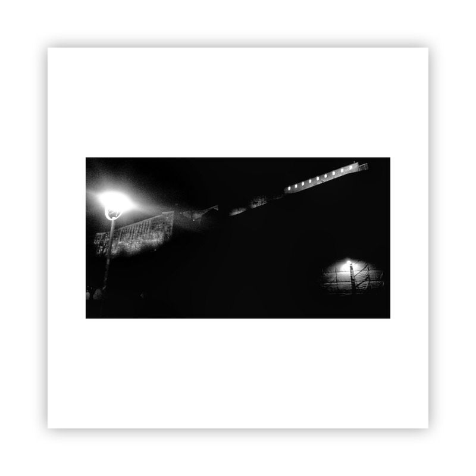

[human-identity.md](human-identity.md)

[training-ground.md](training-ground.md)

[project-inception.md](project-inception.md)

<figure class="embed-media">
  
  <figcaption>awalkaday 8-2018</figcaption>
</figure>

