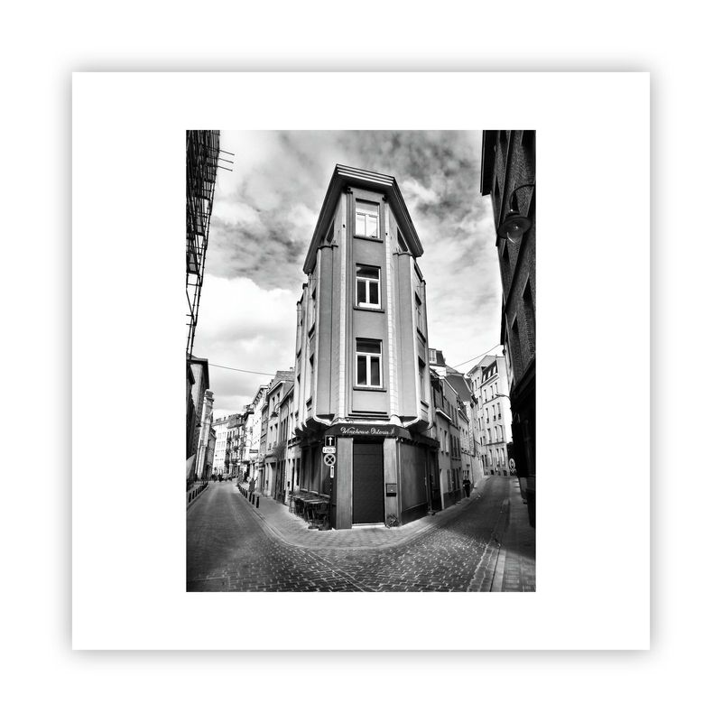

<figure class="embed-media">
  
  <figcaption>awalkaday 71-2022</figcaption>
</figure>

<em><code>awalkaday 71-2022</code></em> → <em>Two paved roads diverge from a single point somewhere in Belgium. The photograph did not intend an allegory. It became one.</em>

The `awalkaday` photo collection evolved since its launch along two pathways that the photographer rarely named as such, because naming them would have required seeing them both at once — and survival, as a daily practice, does not permit that kind of distance.

The first pathway was artistic: walks taken, photographs made, code committed, tokens minted, galleries built. The second pathway was legal: forms filed, interviews endured, appeals submitted, decisions absorbed, silences waited through. Both pathways demanded proofs of documentation — pieces of evidence about a life genuinely immersed in Belgian landscapes. The art practice produced that evidence without knowing it was needed. The asylum procedure consumed it without knowing it existed.

Running alongside these two, other parallels accumulated. Physical exclusion and digital inclusion moved in opposite directions at the same speed: every door the administrative system closed, a distributed network held open. Equipment losses and legal rejections arrived in clusters, each cluster followed by recovery. Two identities — one civic and contested, one digital and immutable — developed simultaneously, the second growing more permanent as the first grew more precarious.

Both roads, from where and when `awalkaday 71-2022` was shot, lead somewhere outside the frame.

