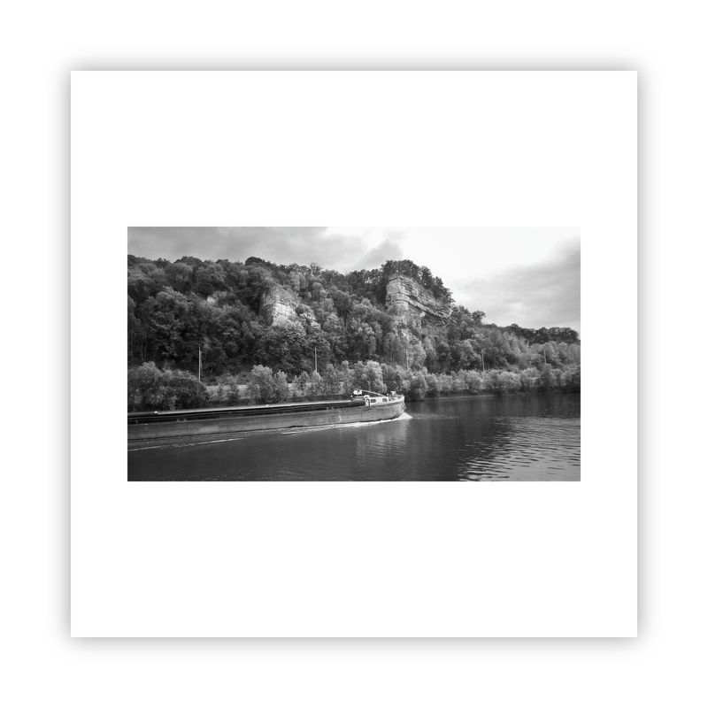

[instagram.md](instagram.md)

[github.md](github.md)

[web-gallery.md](web-gallery.md)

[x-twitter.md](x-twitter.md)

[ethereum.md](ethereum.md)

<figure class="embed-media"><figcaption>awalkaday 25-2022</figcaption></figure>
