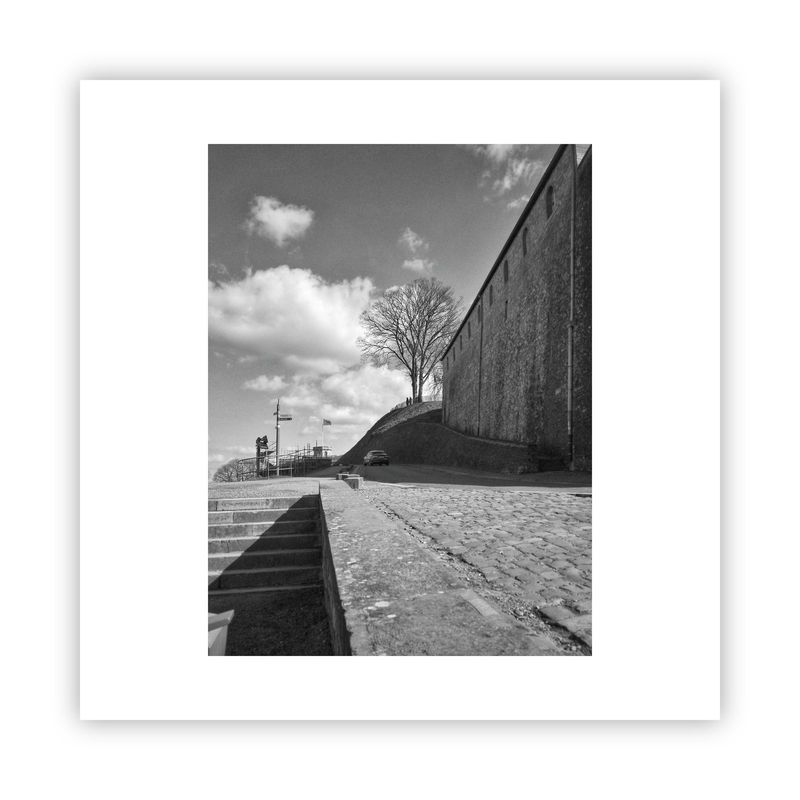

[Instagram](https://instagram.com/) enables users to showcase their creativity and to connect by affinity to imagery and visual storytelling.

  

The monochrome photographs were originally posted on Instagram by [@walk.day](https://www.instagram.com/walk.day/) (managed by [@iamdaqhris](https://www.instagram.com/iamdaqhris/)), on an almost daily basis, continuously for years. Each photograph is accompanied by its city location and a timestamp.

In total, 454 photographs have been showcased on Instagram. They all carry the hashtag [#awalkaday](https://www.instagram.com/explore/tags/awalkaday/), as envisioned in summer 2017. This has been consistent all the way back to the first social media post.

<figure class="embed-media">
  
<figcaption>awalkaday 167-2021</figcaption></figure>
