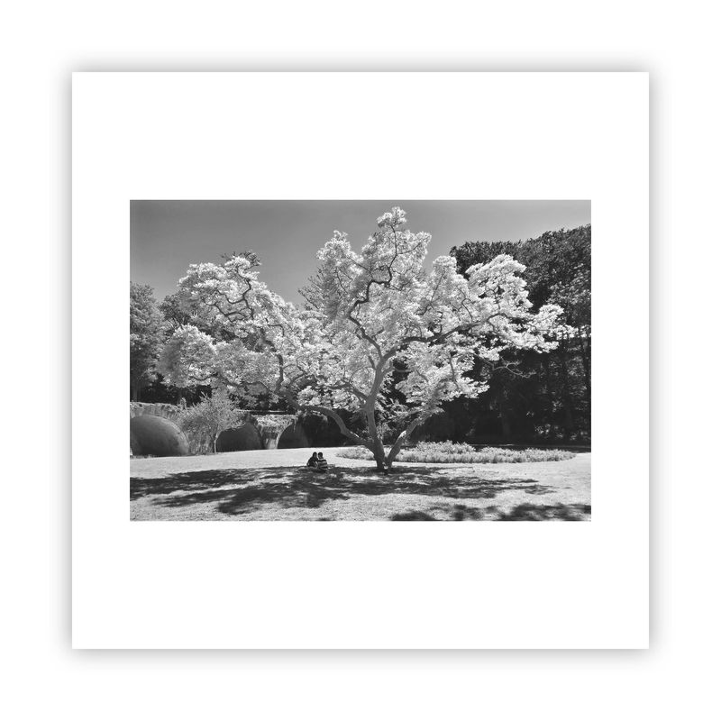

<h4 align="center"></h4>

<figure class="embed-media">
  
  <figcaption>awalkaday 251-2022</figcaption>
</figure>

<h4 align="right"></h4>

<h3 align="right">Chris-Armel <strong>Iradukunda</strong> <a href="https://daqhris.com/"><code>daqhris</code></a></h3>

<h4 align="center"> </h4>

<em>Ceci <del>n' (crossed out)</del> est <del>pas (crossed out)</del> un Livre d'Artiste Sans Papier.</em>

